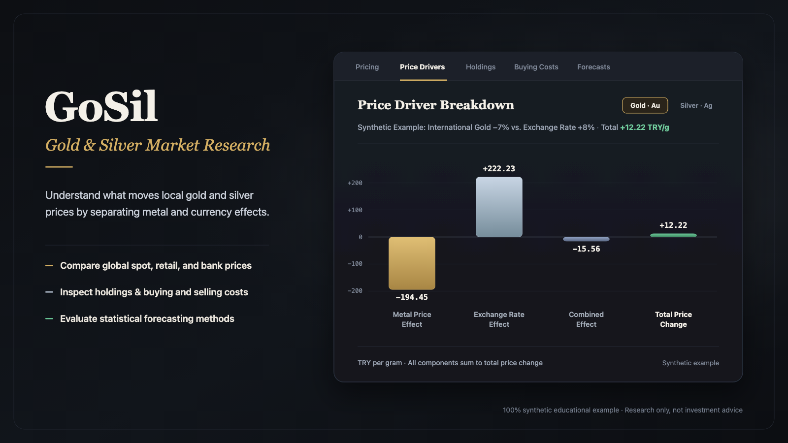

# GoSil



**GoSil** is a gold and silver market research workspace designed to help users understand what moves local precious-metals prices. It distinguishes international metal-price changes from exchange-rate effects, compares global benchmarks against local retail and bank pricing, explores holdings and transaction records, measures buying and selling costs, and evaluates statistical forecasting methods against simple baselines.

> **Interactive Browser Preview:** [https://erturkeryavuz.github.io/gosil-analytics-demo/](https://erturkeryavuz.github.io/gosil-analytics-demo/) — static browser preview running on 100% synthetic educational examples (also runnable locally via the command below).

---

## Core Capabilities

- **Gold & Silver Price Breakdown:** Interactive calculator showing how much of a local `TRY/g` price change comes from the international metal price, the `USD/TRY` exchange rate, and their combined effect.
- **Gold & Silver Pricing Layers:** Keeps six distinct price layers separate across gold (`Au`) and silver (`Ag`)—international spot reference, exchange rate, theoretical gram parity, local retail reference, synthetic bank bid/ask quote, and realized net cost.
- **Holdings & Transaction Records:** Tracks synthetic gold and silver lots with weighted-average cost, demonstrates auditable append-only reversals when correcting an entry without erasing history, and keeps physical coin/bar holdings separate from bank quotes.
- **Buying & Selling Costs:** Measures bid-ask spreads and immediate buy-to-sell costs while automatically withholding stale (`> 900s`) or malformed (`ask < bid`) quotes.
- **Statistical Forecast Research:** Tests `naive`, `drift`, and `damped_trend` models across synthetic 36-month sequences using chronological walk-forward validation, promoting a challenger only when it improves meaningfully (`>= 5%` dev MAE) and displaying empirical error sensitivity bands (`probability: null`).

---

## Technology Stack

- **Original Private Engine (Frozen Local-First Repository):** Python 3.11+ standard library only (`sqlite3`, `fractions`, `decimal`, `http.server`), SQLite `STRICT` append-only schema with `0700`/`0600` vault permissions, SHA-256 verified online backups, and a `127.0.0.1` loopback foreground server (`REAL_OWNER_FIRST_READ_AUTHORIZED = False`).
- **Static Browser Preview (This Repository):** Zero-dependency HTML5, CSS3, vanilla JavaScript (`BigInt` fixed-point math), and data-grounded SVG charts running entirely client-side over 100% synthetic fixtures.

---

## Architecture & Methodology

- **Exact Unit & Precision Contracts:** Monetary amounts are stored as exact integer `e4` units (`0.0001 TRY`), masses as exact integer `ug` (`0.000001 g`), and troy-ounce conversions use the exact NIST constant `31.1034768 g / troy oz` to prevent binary floating-point drift.
- **Strict Separation of Price Semantics:** Theoretical `TRY/g` parity is never treated as an executable bank bid or physical dealer quote; physical lots preserve unknown acquisition cost as `null` rather than fabricating zero.
- **Conservative Statistical Discipline:** Challengers (`drift`, `damped_trend`) are surfaced only when they beat the `naive` random-walk baseline by `>= 5%` on development MAE under purged walk-forward folds. Qualitative retrospective notes from private research record that silver (`h=3`, `h=6`) and short horizons behaved near-random-walk and that revised monthly statistical averages never establish live predictive edge.

---

## Explore Locally

No build step, API key, or package installation is required:

```bash
python3 -m http.server 8000 --directory docs
# Open http://127.0.0.1:8000/
```

Use the top navigation tabs (`Overview`, `Market Structure`, `Currency Drivers`, `Portfolio Ledger`, `Spread & Freshness`, `Forecast Evaluation`, `Architecture`) to explore manually, or launch the optional **Watch Tutorial** from the header for a 6-step guided walkthrough with sticky playback controls and automatic session restoration on exit.

---

## Data Provenance & Frozen Scope

- **Frozen Historical Archive:** Active feature development of GoSil is discontinued (final private milestone: D23 locked read-only readiness, `2026-11-16`).
- **100% Synthetic Public Data:** External statistical providers carried non-retention constraints in the private engine, and private owner ledgers stay strictly outside Git. Every price, exchange rate, lot, spread, and 36-month forecast series in this public preview is **100% synthetic**—containing zero real holdings, zero external market observations, and zero live feeds.
- **No LLM Prediction Engine or Investment Advice:** GoSil does not implement an LLM or machine-learning prediction oracle, does not connect to bank or brokerage accounts, omits after-tax liquidation calculations, and is strictly for software engineering and financial research demonstration.

---

## Testing & Reproducibility

- **Standalone Public Preview Verification:** Run the deterministic offline test suite (Python 3.9+ standard library and Node.js syntax checks; requires no private repository or network calls):

```bash
python3 -B -m unittest discover -s tests -v
```

- **Original Private Repository Verification Record:** The frozen private engineering repository recorded `739 / 739` passing offline `pytest` tests and `205` UI3 contract/security checks across fixed-point accounting, SQLite triggers, backup integrity, quote eligibility, walk-forward evaluation, and desktop runtime security.

---

## Attribution & Licensing

- Complete synthetic-data boundary, non-affiliation, and non-advisory notices are published in [`docs/THIRD-PARTY-NOTICES.md`](docs/THIRD-PARTY-NOTICES.md) and [`docs/notices.html`](docs/notices.html).
- No root open-source `LICENSE` file is declared without separate owner authorization.
